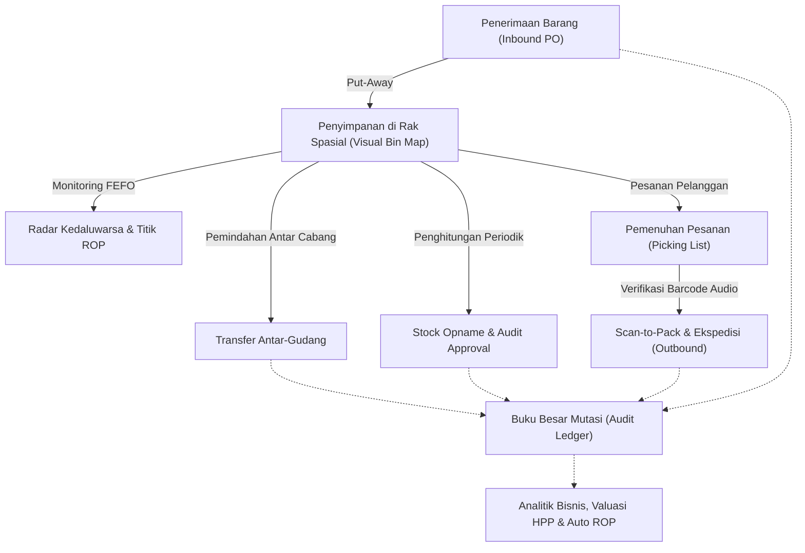
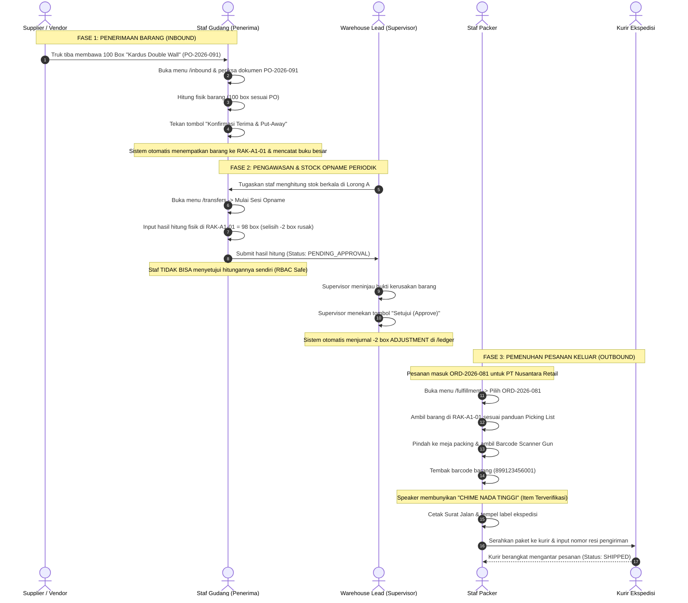

# Buku Panduan Operasional & Manual Pengguna
## NexStock WMS — Enterprise Multi-Warehouse Inventory Control

---

## 1. Pendahuluan & Konsep Inti Sistem

NexStock WMS adalah platform manajemen pergudangan multi-cabang skala enterprise yang dirancang untuk mengotomatisasi, melacak, dan mengaudit setiap perpindahan barang secara *real-time*.

### Prinsip Utama Sistem:
1. **Multi-Warehouse Isolation & Hierarchy:**
   Setiap cabang gudang (*Gudang Pusat Jakarta, Gudang Distribusi Surabaya, Hub Logistik Medan*) memiliki catatan inventaris, peta rak, dan mutasi terpisah, namun dapat dipantau secara terkonsolidasi oleh *Super Admin*.
2. **Immutable Audit Ledger (Buku Besar Permanen):**
   Tidak ada kuantitas stok yang dapat diubah atau dihapus secara langsung. Setiap penambahan, pengurangan, pemindahan rak, atau penyesuaian wajib melalui pencatatan mutasi (*Stock Movement*) yang mencatat nilai HPP, nomor referensi dokumen, dan identitas staf penanggung jawab.
3. **Pemisahan Tugas (*Segregation of Duties / RBAC*):**
   Staf pelaksana di lantai gudang tidak diizinkan menyetujui (*approve*) selisih hitung fisik mereka sendiri pada proses *Stock Opname*. Otorisasi penyesuaian nilai buku hanya dapat disahkan oleh *Warehouse Lead* atau *Super Admin*.
4. **FEFO (First Expired, First Out) Prioritization:**
   Barang dengan tanggal kedaluwarsa paling dekat wajib dialokasikan keluar terlebih dahulu guna mencegah kerugian finansial akibat barang usang (*spoilage/dead stock*).

---

## 2. Struktur Hak Akses (Role-Based Access Control / RBAC)

| Modul / Fitur | Staf Operasional (`WAREHOUSE_STAFF`) | Kepala Gudang (`WAREHOUSE_LEAD`) | Direktur / IT (`SUPER_ADMIN`) |
| :--- | :---: | :---: | :---: |
| **Pindah Cabang Gudang Aktif** | Sesuai Penugasan | Sesuai Penugasan | Bebas Semua Cabang |
| **Tambah Cabang Gudang Baru** | ❌ Dibatasi | ❌ Dibatasi | ✅ Akses Penuh |
| **Tambah Master SKU Produk & HPP** | ❌ Dibatasi | ✅ Akses Penuh | ✅ Akses Penuh |
| **Scan Barcode & Catat Mutasi** | ✅ Akses Penuh | ✅ Akses Penuh | ✅ Akses Penuh |
| **Penerimaan Inbound PO Supplier** | ✅ Akses Penuh | ✅ Akses Penuh | ✅ Akses Penuh |
| **Picking & Scan-to-Pack Pesanan** | ✅ Akses Penuh | ✅ Akses Penuh | ✅ Akses Penuh |
| **Input Hitung Fisik Stock Opname** | ✅ Input Fisik | ✅ Input Fisik | ✅ Input Fisik |
| **Persetujuan (Approval) Opname** | ❌ Dibatasi | ✅ Otomatisasi Jurnal | ✅ Otomatisasi Jurnal |
| **Kirim & Terima Transfer Antar-Gudang** | Membantu Scan | ✅ Otorisasi Dokumen | ✅ Otorisasi Dokumen |
| **Analitik Bisnis & Ekspor Excel** | ❌ Dibatasi | ✅ Akses Penuh | ✅ Akses Penuh |

---

## 3. Penjelasan Lengkap 8 Modul Sistem

### Modul 1: Dasbor Utama (`/`)
* **Tujuan:** Pusat komando operasional untuk memantau status kesehatan gudang secara instan.
* **Fitur Utama:**
  * **Stat Strip (4 Kartu Metrik):** Menampilkan total unit fisik, total valuasi aset gudang aktif (berbasis HPP), jumlah SKU menipis/kritis, dan *batch* mendekati masa kedaluwarsa.
  * **Visual Bin Map 2D:** Visualisasi kapasitas rak terisi dalam persentase warna (*Normal: Hijau, Menipis: Kuning/Merah, Penuh: Biru*).
  * **FEFO Expiry Radar:** Daftar *batch* dengan *countdown* sisa hari kedaluwarsa dan tombol satu klik *"Keluarkan"* untuk memprioritaskan stok.
  * **Aktivitas Mutasi Hari Ini:** *Live feed* transaksi barang masuk (*IN*), keluar (*OUT*), dan transfer (*TRANSFER*).

### Modul 2: Inventaris & Rak (`/inventory`)
* **Tujuan:** Manajemen master katalog produk, penelusuran lokasi rak, dan kemasan bertingkat.
* **Fitur Utama:**
  * **Multi-UoM (Unit of Measure):** Satu produk dapat memiliki satuan dasar (misal: *pcs*) dan satuan kemasan grosir (misal: *1 ikat = 10 pcs*, *1 karton = 100 pcs*) dengan barcode masing-masing.
  * **Pencarian & Filter Cepat:** Cari berdasarkan SKU, nama produk, kategori, atau filter status (*Stok Aman*, *Menipis*, *Habis*).
  * **Cetak Barcode Label:** Menghasilkan stiker barcode standar Code-128 dan QR Code siap tempel ke kemasan fisik.

### Modul 3: Penerimaan Barang Masuk (`/inbound`)
* **Tujuan:** Verifikasi barang yang dikirim oleh vendor pemasok berdasarkan Purchase Order (PO).
* **Fitur Utama:**
  * **Daftar Dokumen PO:** Menampilkan nomor PO, nama vendor, tanggal estimasi, dan status verifikasi.
  * **Verifikasi Hitungan:** Pencocokan jumlah barang yang dipesan (*Ordered Qty*) dengan barang yang diterima secara fisik (*Received Qty*).
  * **Saran Penempatan Rak (*Put-Away Recommendation*):** Sistem otomatis merekomendasikan kode rak tujuan (misal: `RAK-A1-01`) berdasarkan kapasitas rak yang masih longgar.

### Modul 4: Pemenuhan Pesanan & Scan-to-Pack (`/fulfillment`)
* **Tujuan:** Memproses pesanan penjualan keluar pelanggan dengan jaminan akurasi 100% (*zero picking error*).
* **Fitur Utama:**
  * **Tahap 1 - Picking List:** Menampilkan daftar barang pesanan yang diurutkan berdasarkan lokasi rak terdekat (*Aisle -> Rack -> Tier*) untuk menghemat langkah staf di gudang.
  * **Tahap 2 - Scan-to-Pack (Verifikasi Audio Hardware):** Staf memindai barcode fisik barang menggunakan *barcode scanner gun*. Sistem membunyikan *chime audio* positif jika barang cocok, atau membunyikan alarm negatif jika salah barang.
  * **Tahap 3 - Dispatch & Shipping Label:** Penginputan nama kurir logistik (*JNE, SiCepat, Internal Trucking*), nomor resi pelacakan, dan tombol cetak Surat Jalan / Packing Slip resmi.

### Modul 5: Transfer Antar-Gudang & Stock Opname (`/transfers`)
* **Tujuan:** Menjaga keseimbangan stok antar-cabang dan memastikan kepatuhan inventaris fisik.
* **Fitur Utama:**
  * **Transfer Antar-Cabang:** Pengiriman muatan dari gudang asal dengan status `IN_TRANSIT` hingga diverifikasi dan diterima oleh gudang penerima (`COMPLETED`).
  * **Stock Opname (Hitung Fisik):** Staf menginput hasil hitungan lapangan. Sistem menghitung selisih (*variance*) terhadap data sistem.
  * **Two-Person Approval Rule:** Tombol hijau *"Setujui Opname"* hanya muncul jika pengguna berstatus *Lead* atau *Admin*. Begitu disetujui, sistem otomatis mencatat penyesuaian (*ADJUSTMENT*) ke buku besar.

### Modul 6: Buku Besar Audit (`/ledger`)
* **Tujuan:** Menyediakan jejak audit (*audit trail*) keuangan dan logistik yang tidak dapat direkayasa.
* **Fitur Utama:**
  * Setiap mutasi mencatat tipe transaksi (*IN, OUT, TRANSFER_IN, TRANSFER_OUT, ADJUSTMENT*).
  * Nilai biaya pokok per unit (HPP) dan total nilai rupiah transaksi.
  * Nomor dokumen acuan (PO, DO, Surat Jalan, Opname No).
  * Nama pengguna yang membuat (*Created By*) dan yang menyetujui (*Approved By*).

### Modul 7: Analitik Bisnis & Auto Re-Order Point (`/analytics`)
* **Tujuan:** Analisis perputaran modal, pencegahan kekosongan stok (*zero stockout*), dan kalkulasi pemesanan ulang otomatis.
* **Fitur Utama:**
  * **Kalkulator Auto ROP:** Menggunakan formula industri: ROP = (Konsumsi Harian x Lead Time Vendor) + Safety Stock.
  * **Simulasi Lead Time:** Ubah *lead time* vendor (3, 5, 7, 14 hari) untuk melihat perubahan titik aman secara dinamis.
  * **Deteksi Dead Stock:** Mengidentifikasi produk lambat berputar (>60 hari) yang mengendapkan modal perusahaan.
  * **Draft PO Sekali Klik:** Tombol cepat untuk langsung menerbitkan dokumen pesanan pengadaan ke vendor.
  * **Ekspor Excel CSV:** Unduh laporan lengkap evaluasi stok dan valuasi modal dalam format `.csv` siap cetak.

### Modul 8: Autentikasi & Profil Pengguna (`/login`)
* **Tujuan:** Pintu gerbang keamanan sistem dan manajemen sesi.
* **Fitur Utama:**
  * Login dengan email & password terenkripsi.
  * *Quick Demo Switcher* untuk pengujian cepat peran *Super Admin*, *Warehouse Lead*, dan *Warehouse Staff*.
  * *Authenticated User Profile Menu* di sudut kanan atas untuk mengecek penugasan gudang dan keluar sesi (*Logout*) secara aman.

---

## 4. Alur Kerja Nyata (End-to-End Walkthrough)

Berikut adalah simulasi skenario operasional dari barang pertama kali tiba di pintu gerbang hingga dikirimkan ke tangan pembeli:

### Langkah Demi Langkah Pelaksanaan:

#### Langkah 1: Menerima Barang dari Supplier (Inbound)
1. Buka menu **Penerimaan Barang** di navigasi kiri (`/inbound`).
2. Temukan dokumen PO pemasok yang sedang tiba (misal: `PO-2026-091`).
3. Periksa kondisi fisik kemasan dan cocokkan jumlah barang:
   * Masukkan jumlah aktual di kolom **Jumlah Diterima** (misal: `100 box`).
4. Klik tombol **"Terima Barang & Tempatkan ke Rak"**.
5. Sistem secara atomik:
   * Menambahkan kuantitas fisik ke rak tujuan (`RAK-A1-01`).
   * Mencatat mutasi debit `IN` sebesar 100 box dengan nilai HPP Rp 6.500/box (Total: Rp 650.000) di **Buku Besar Audit**.

#### Langkah 2: Memantau Stok & Titik Pemesanan Ulang (ROP)
1. Buka menu **Analitik Bisnis** (`/analytics`).
2. Perhatikan kartu **Valuasi Aset Fisik (HPP)** yang otomatis bertambah sesuai stok yang baru masuk.
3. Amati kolom **Titik ROP**:
   * Jika stok fisik berada di atas ROP -> status berwarna hijau (*Optimal*).
   * Jika stok menyentuh atau berada di bawah ROP -> status berubah merah (*Perlu Reorder*).
4. Jika ada item kritis, klik tombol **"Draft PO"** untuk langsung menyiapkan pengadaan restock berikutnya.

#### Langkah 3: Melakukan Stock Opname (Audit Selisih)
1. Buka menu **Transfer & Opname** (`/transfers`) lalu klik tab **Stock Opname**.
2. Klik tombol **"Mulai Sesi Opname Baru"**.
3. Staf lapangan berkeliling menghitung jumlah fisik di rak dan memasukkan angka riil.
4. Klik **"Kirim Hasil Hitung Opname"**. Status dokumen menjadi `PENDING_APPROVAL`.
5. *Warehouse Lead* atau *Super Admin* membuka dokumen tersebut, memverifikasi selisih, lalu mengklik **"Setujui (Approve)"**.
6. Sistem otomatis menyeimbangkan kuantitas stok di rak dan mencatat mutasi `ADJUSTMENT` di `/ledger`.

#### Langkah 4: Memproses Pesanan Keluar (Scan-to-Pack Outbound)
1. Buka menu **Pemenuhan Pesanan** (`/fulfillment`).
2. Klik pesanan yang berstatus `PENDING_PICK` (misal: `ORD-2026-081`).
3. **Tahap Picking:** Staf mengambil barang dari rak sesuai urutan lokasi yang tertera di layar. Klik *"Konfirmasi Selesai Ambil"*.
4. **Tahap Packing:**
   * Di atas meja packing, staf mengambil scanner barcode hardware.
   * Pindai barcode stiker barang (atau gunakan kamera HP / input keyboard).
   * Speaker perangkat akan membunyikan nada positif (**Chime Tinggi**) dan progress bar bertambah secara instan.
   * Jika staf salah memindai barang yang tidak ada di daftar pesanan, speaker akan membunyikan nada peringatan (**Buzzer Rendah**) untuk mencegah salah kirim.
5. **Tahap Pengiriman (Shipping):**
   * Setelah seluruh barang terverifikasi lengkap (100%), sistem otomatis berpindah ke tab Pengiriman.
   * Masukkan nama ekspedisi (misal: *JNE Trucking*) dan nomor resi.
   * Klik tombol **"Cetak Dokumen Surat Jalan"** untuk mencetak packing slip resmi.
   * Klik **"Selesaikan & Kirim Pesanan"**.
   * Stok di gudang otomatis terpotong, mutasi `OUT` tercatat di buku besar, dan pesanan berstatus `SHIPPED`.

---

## 5. Tombol Pintas & Tips Efisiensi Kerja (*Productivity Hacks*)

1. **Hotkey Pemindai Barcode (`B`):**
   Di layar manapun Anda berada, tekan tombol huruf **`B`** pada keyboard untuk membuka modal Pemindai Barcode Industri secara instan tanpa menyentuh mouse.
2. **Mode Layar Penuh Handheld (PWA):**
   Buka web di browser ponsel/tablet gudang, lalu pilih menu browser **"Tambahkan ke Layar Utama" / "Add to Home Screen"**. Aplikasi akan berjalan seperti aplikasi native tanpa bilah URL yang mengganggu.
3. **Indikator Ketahanan Offline:**
   Jika sinyal WiFi gudang drop saat berada di dalam lorong pendingin atau kontainer baja, bilah peringatan kuning akan muncul. Transaksi tetap tercatat di memori lokal dan akan disinkronkan otomatis saat sinyal kembali pulih.
4. **Ekspor Laporan Bulanan:**
   Gunakan tombol **"Ekspor Analitik Excel"** di menu `/analytics` untuk keperluan rapat anggaran manajemen atau audit akuntansi perpajakan.

---
*Manual ini disusun secara resmi untuk operasional sistem NexStock WMS Enterprise.*
