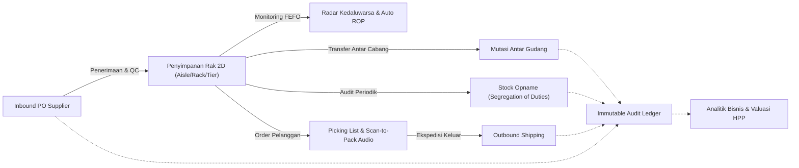

# 📦 NexStock WMS — Multi-Warehouse Inventory Control & Analytics

[](https://nextjs.org/)
[](https://react.dev/)
[](https://www.typescriptlang.org/)
[](https://tailwindcss.com/)
[](https://supabase.com/)
[](https://nextstock-wms.vercel.app)
[](https://nextstock-wms.vercel.app)

> **Enterprise-grade Multi-Warehouse Management System (WMS)** yang mengintegrasikan pemetaan rak spasial 2D (*Visual Bin Map*), kontrol mutasi *immutable ledger*, prioritas rotasi kedaluwarsa **FEFO**, otomasi **Re-Order Point (ROP)**, serta verifikasi pemenuhan pesanan berbasis *Hardware Barcode Scanner & Web Audio API*.

🌐 **Live Production Demo:** [https://nextstock-wms.vercel.app](https://nextstock-wms.vercel.app)  
📖 **Manual Pengguna Lengkap:** [PANDUAN_PENGGUNAAN_WMS.md](PANDUAN_PENGGUNAAN_WMS.md)

---

## 🚀 Fitur Unggulan Sistem (Key Highlights)



1. **Multi-Warehouse Isolation & Hierarchy:**
   * Manajemen inventaris multi-cabang terisolasi (*Gudang Pusat Jakarta, Gudang Distribusi Surabaya, Hub Logistik Medan*).
   * Pemilihan cabang aktif secara instan dengan sinkronisasi mutasi dan peta rak otomatis.

2. **Visual Bin Storage 2D (Aisle, Rack, Tier):**
   * Pemetaan fisik visual rak gudang per lorong (*Aisle*), kolom rak (*Rack*), dan tingkat (*Tier*).
   * Kapasitas maksimum per bin dengan indikator persentase okupansi dinamis (Normal, Kritis, Penuh).

3. **FEFO (First Expired, First Out) & Batch Tracking:**
   * Alokasi barang otomatis memprioritaskan batch dengan masa kedaluwarsa terdekat guna mencegah kerugian finansial akibat barang usang (*dead stock*).
   * Radar kedaluwarsa otomatis mengkategorikan batch: *Aman*, *Waspada (< 30 hari)*, dan *Kritis (< 14 hari)*.

4. **Immutable Audit Ledger (Buku Besar Mutasi Permanen):**
   * Setiap penambahan stok, pengeluaran, pemindahan rak, atau koreksi audit tercatat dalam buku besar permanen (*non-destructive ledger*) yang melacak nomor referensi dokumen, nilai HPP, timestamp, dan staf penanggung jawab.

5. **Scan-to-Pack dengan Web Audio Feedback & Barcode Scanner Wedge:**
   * Dukungan *hardware barcode scanner handheld* (USB/Bluetooth) dengan *buffer capture listener* berkecepatan tinggi (<120ms).
   * Umpan balik audio sintetis real-time via **Web Audio API**:
     * 🟢 *Double Beep Frekuensi Tinggi (880Hz → 1320Hz)* saat barcode SKU terverifikasi valid.
     * 🔴 *Buzzer Frekuensi Rendah (220Hz)* saat barang salah atau melebihi kuantitas picking.

6. **Otomatisasi Titik Pemesanan Ulang (Re-Order Point / ROP):**
   * Formula kalkulasi ilmiah: $\text{ROP} = (\text{Konsumsi Harian} \times \text{Lead Time}) + \text{Safety Stock}$.
   * Dasbor peringatan otomatis yang mengidentifikasi SKU di bawah ambang batas dan membuat *Draft Purchase Order (PO)* dengan satu klik.

7. **Pemisahan Tugas (Segregation of Duties / RBAC):**
   * Role-Based Access Control yang ketat: `SUPER_ADMIN`, `WAREHOUSE_LEAD`, dan `WAREHOUSE_STAFF`.
   * Staf gudang yang menginput hitung fisik dilarang menyetujui selisihnya sendiri; otorisasi penyesuaian nilai buku hanya dapat disahkan oleh *Warehouse Lead* atau *Super Admin*.

8. **PWA (Progressive Web App) & Warehouse Offline Resilience:**
   * Dilengkapi `manifest.json`, icon modern, dan konfigurasi viewport mobile anti-zoom.
   * Banner deteksi konektivitas offline otomatis untuk menjamin keandalan kerja di area *blind spot* gudang.

---

## 👥 Hak Akses Pengguna (Role-Based Access Control)

| Fitur / Modul | Staf Operasional (`WAREHOUSE_STAFF`) | Kepala Gudang (`WAREHOUSE_LEAD`) | Direktur / IT (`SUPER_ADMIN`) |
| :--- | :---: | :---: | :---: |
| **Ganti Cabang Gudang** | Sesuai Penugasan | Sesuai Penugasan | Bebas Semua Cabang |
| **Tambah Cabang Gudang Baru** | ❌ Dibatasi | ❌ Dibatasi | ✅ Akses Penuh |
| **Kelola Master SKU & Nilai HPP** | ❌ Dibatasi | ✅ Akses Penuh | ✅ Akses Penuh |
| **Scan Barcode & Catat Mutasi** | ✅ Akses Penuh | ✅ Akses Penuh | ✅ Akses Penuh |
| **Penerimaan Barang (Inbound PO)** | ✅ Akses Penuh | ✅ Akses Penuh | ✅ Akses Penuh |
| **Picking & Scan-to-Pack (Outbound)** | ✅ Akses Penuh | ✅ Akses Penuh | ✅ Akses Penuh |
| **Input Hitung Fisik Stock Opname** | ✅ Input Fisik | ✅ Input Fisik | ✅ Input Fisik |
| **Persetujuan (Approval) Opname** | ❌ Dibatasi | ✅ Otorisasi Jurnal | ✅ Otorisasi Jurnal |
| **Kirim/Terima Transfer Cabang** | Membantu Scan | ✅ Otorisasi Dokumen | ✅ Otorisasi Dokumen |
| **Analitik Bisnis & Valuasi HPP** | ❌ Dibatasi | ✅ Akses Penuh | ✅ Akses Penuh |

---

## 🛠️ Tech Stack & Arsitektur

* **Framework:** [Next.js 14 (App Router)](https://nextjs.org/)
* **UI & Core:** [React 18](https://react.dev/), [TypeScript 5](https://www.typescriptlang.org/)
* **Styling:** [Tailwind CSS 3](https://tailwindcss.com/) dengan arsitektur utility-first yang responsif
* **Icons:** [Lucide React](https://lucide.dev/)
* **Database & Auth:** [Supabase PostgreSQL](https://supabase.com/) & `@supabase/ssr`
* **Audio Hardware Interface:** Web Audio API (Synthesizer Oscillators & Gain Nodes)
* **PWA & Mobile Support:** Web App Manifest, Standalone Display, Viewport Safe-Area

---

## 📁 Struktur Direktori

```text
nexstock-wms/
├── public/
│   ├── manifest.json              # Web App Manifest PWA
│   └── icons/                     # Icon PWA & Mobile Home Screen
├── src/
│   ├── app/
│   │   ├── layout.tsx             # Root layout & PWA viewport config
│   │   ├── page.tsx               # Dasbor utama & Visual Bin Map 2D
│   │   ├── inventory/             # Modul Inventaris, Rak Spasial & SKU Master
│   │   ├── inbound/               # Modul Penerimaan Barang Supplier (PO)
│   │   ├── orders/                # Modul Pemenuhan Pesanan (Picking List)
│   │   ├── transfers/             # Modul Transfer Antar-Gudang & Stock Opname
│   │   ├── ledger/                # Modul Buku Besar Mutasi (Audit Ledger)
│   │   ├── analytics/             # Modul Analitik Bisnis, Valuasi HPP & ROP
│   │   └── manifest.ts            # Dynamic Next.js PWA Manifest
│   ├── components/
│   │   ├── layout/
│   │   │   ├── AppShell.tsx       # Header, Sidebar, Offline Banner & Profile Switcher
│   │   │   └── Sidebar.tsx        # Navigasi 8 modul & status cabang
│   │   └── modals/
│   │       ├── BarcodeScannerModal.tsx    # Modal Scanner & Global Hardware Wedge
│   │       ├── OrderFulfillmentModal.tsx  # Scan-to-Pack Verifier & Web Audio Synth
│   │       ├── StockOpnameApprovalModal.tsx # Approval Audit Selisih Hitung Fisik
│   │       └── StockTransferModal.tsx     # Dispatch & Penerimaan Antar-Gudang
│   ├── context/
│   │   └── inventory-store.tsx    # Global State, UUID Store & RBAC Session
│   └── lib/
│       ├── audio.ts               # Web Audio API Synthesizer (Success & Error Beep)
│       ├── mock-data.ts           # Enterprise Mock Data Seed (SKU, Bins, Movements)
│       └── supabase.ts            # Supabase Client Factory
├── PANDUAN_PENGGUNAAN_WMS.md      # Buku Panduan Operasional Lengkap
├── package.json
├── tailwind.config.ts
└── tsconfig.json
```

---

## ⚡ Memulai (Getting Started)

### Prasyarat
* [Node.js](https://nodejs.org/) versi `18.17` atau lebih tinggi
* [npm](https://www.npmjs.com/) atau [pnpm](https://pnpm.io/)

### 1. Clone Repository
```bash
git clone https://github.com/najwamarufabyadhi/nextstock-wms.git
cd nextstock-wms
```

### 2. Instalasi Dependensi
```bash
npm install
```

### 3. Konfigurasi Environment Variables
Salin file `.env.example` ke `.env.local` (opsional jika menggunakan Supabase live):
```env
NEXT_PUBLIC_SUPABASE_URL=https://your-project.supabase.co
NEXT_PUBLIC_SUPABASE_ANON_KEY=your-anon-key
```

### 4. Menjalankan Server Pengembangan Lokal
```bash
npm run dev
```
Buka browser Anda dan navigasikan ke `http://localhost:3000`.

### 5. Build untuk Produksi
```bash
npm run build
npm run start
```

---

## 🔑 Akun Demo & Eksplorasi Role

Untuk mengeksplorasi hak akses dari masing-masing role di sistem, gunakan dropdown profil terautentikasi di sudut kanan atas:

1. **Hendrik Wijaya (Super Admin):**
   * *Akses:* Bebas berpindah ke seluruh cabang gudang, tambah cabang gudang baru, kelola SKU & HPP, dan otorisasi jurnal selisih audit.
2. **Bambang Pratama (Warehouse Lead — Gudang Jakarta):**
   * *Akses:* Approval audit stock opname, otorisasi dokumen transfer keluar-masuk, serta evaluasi analitik valuasi aset gudang.
3. **Agus Santoso (Warehouse Staff — Operator Lantai):**
   * *Akses:* Operasional harian (Scan barcode, Penerimaan barang PO, Picking pesanan, dan Input hitung fisik). Menu analitik dan tombol approval otomatis terkunci demi integritas kepatuhan audit.

---

## ⌨️ Pintasan Efisiensi Kerja (Productivity Hacks)

* Tekan tombol keyboard **`B`** dari layar manapun untuk membuka pemindai barcode instan.
* Gunakan scanner barcode fisik USB/Bluetooth dalam mode *Keyboard Wedge* untuk input instan tanpa klik mouse.
* Pasang sebagai aplikasi desktop/ponsel melalui tombol browser **"Add to Home Screen" (PWA)** untuk performa native bebas bar navigasi browser.

---

## 📄 Lisensi & Kontributor

Dikembangkan dengan dedikasi tinggi untuk modernisasi sistem logistik dan pergudangan Indonesia.

* **Pengembang:** [Muhammad Najwa Ma'ruf Abyadhi](https://github.com/najwamarufabyadhi) — *Software Engineer // AI & Data Science*
* **Portofolio:** [portofolio-teal-xi.vercel.app](https://portofolio-teal-xi.vercel.app)
* **Lisensi:** MIT License — silakan digunakan dan dikembangkan untuk kebutuhan operasional maupun edukasi.
